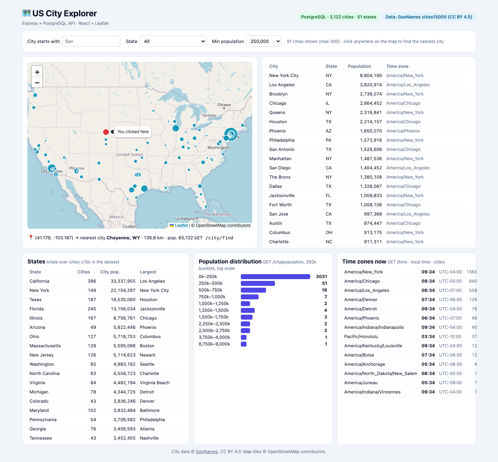
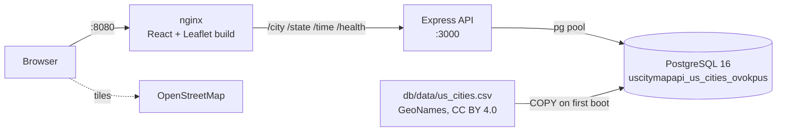
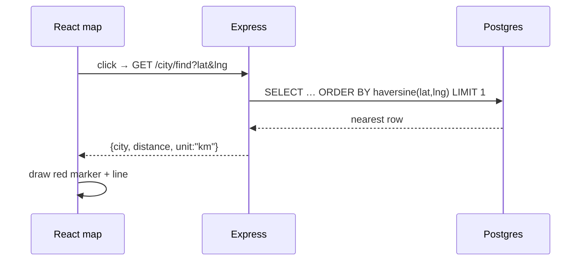
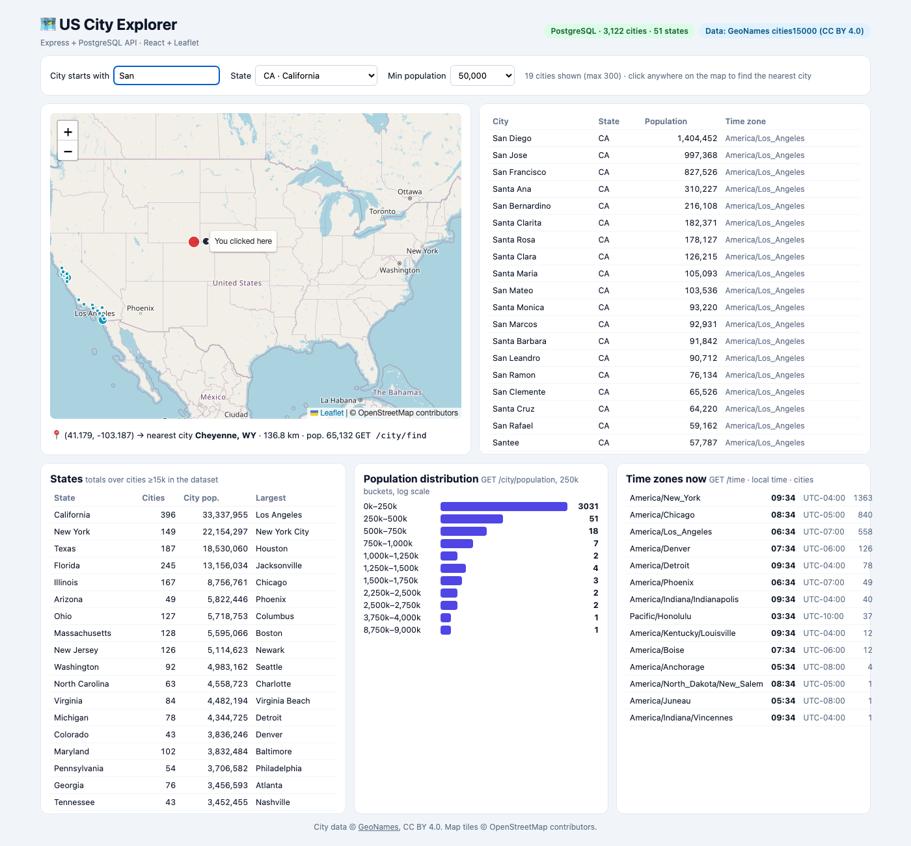

# 🗺️ US City API

<p align="center"></p>

**A small Express + PostgreSQL API for US cities, now with a one-command local stack and a React map UI.**

`docker compose up` → PostgreSQL seeded with **3,122 real US cities** → Express API on `:3000` → React + Leaflet explorer on `:8080`.



---

## 1. The problem

The original project ([docs/ORIGINAL_README.md](docs/ORIGINAL_README.md)) was an Express API over a hosted Postgres table of US cities. It had no seed data, no container setup, and no tests. Its "nearest city" lookup used flat Euclidean distance on lat/lng. This branch makes it run anywhere in one command and keeps the API it already had.

## 2. Architecture

<p align="center"></p>



## 3. Quick start

```bash
cp .env.example .env        # local-only defaults, no secrets
docker compose up -d --build
open http://localhost:8080  # UI
curl localhost:3000/health  # {"status":"ok","database":true,"cities":3122,...}
docker compose down         # add -v to drop the seeded volume
```

Without Docker: `npm ci && npm test`. To run the API on its own, point `DATABASE_URL` at any Postgres and run `npm run dev`. For the UI, run `cd frontend && npm ci && npm run dev`; Vite proxies the API to `:3000`.

## 4. API

| Endpoint | Status | What it returns |
|---|---|---|
| `GET /city?page_num=&page_size=` | original | `[{id, city}]` sorted by name (page_size capped at 1000) |
| `GET /city/:id` | original | one city row |
| `GET /city/find?lat=&lng=` | original, **fixed** | nearest city by **haversine km**; returns 400 on bad input |
| `GET /city/population?bucket_size=` | original | cities grouped into population buckets |
| `GET /state?page_num=&page_size=` / `?id=` | original | `[{id, state}]` |
| `GET /time` | original, **fixed** | each time zone in the data with its correct local time and UTC offset |
| `GET /city/search?q=&state_id=&min_population=&limit=` | new | prefix search, sorted by population |
| `GET /state/stats` | new | cities, combined city population, and largest city per state |
| `GET /health` | new | DB check and row counts (503 + `degraded` if the DB is down) |

These are real responses from the running stack, saved in [docs/screenshots/api-samples.json](docs/screenshots/api-samples.json):

```json
GET /city/find?lat=40.0&lng=-105.3
{ "city": { "id": 302, "name": "Boulder", "state_id": "CO", "lat": 40.01499, "lng": -105.27055, "population": 106803 },
  "distance": 3.01, "unit": "km" }
```



## 5. The UI

| Search + filters | Explorer |
|---|---|
|  |  |

- **Map:** circles are sized by population. Click anywhere to call `/city/find`.
- **Filters:** search by name prefix, state, and minimum population (`/city/search`).
- **State table:** click a row to filter by that state (`/state/stats`).
- **Histogram:** log-scaled population buckets (`/city/population`).
- **Clocks:** live local time for each time zone (`/time`).

Both screenshots were taken with headless Playwright against the running stack (`scripts/screenshots.py`).

## 6. Data

`db/data/us_cities.csv` is built from **GeoNames `cities15000`** (populated places with ≥15k people), licensed CC BY 4.0. Source details and attribution are in [db/data/SOURCE.md](db/data/SOURCE.md), and `scripts/build_cities_csv.py` rebuilds the file. Postgres loads it once on first boot from `db/init/01_schema.sql`. GeoNames lists NYC's boroughs (Brooklyn, Queens, …) as separate places, so the data does too.

## 7. What changed on this branch

- **Containers:** `Dockerfile` (node 20 alpine, production deps only) and `docker-compose.yml` (Postgres with a healthcheck → API → nginx frontend).
- **Data:** a real, attributed seed dataset plus a schema with indexes.
- **Bug fixes:**
  - The nearest-city lookup now uses haversine distance instead of Euclidean.
  - `/time` now returns the correct time.
  - The broken `nodemon --watch` start script now works.
  - `PORT` defaults to 3000.
  - Bad input to `/city/find` gets a 400.
  - `page_size` is capped at 1000.
- **New endpoints:** `/health`, `/city/search`, `/state/stats`. Removed the unused `moment-timezone` dependency.
- **Tests:** Jest + supertest with a mocked pg pool (`__tests__/`). CI runs them, builds the frontend, then runs `docker compose build`.
- **Moves, no deletes:** old README → `docs/ORIGINAL_README.md`, `img/` → `docs/img/`.
- **Config:** `.env.example` holds local defaults only. There is no auth, because this is a local demo.
